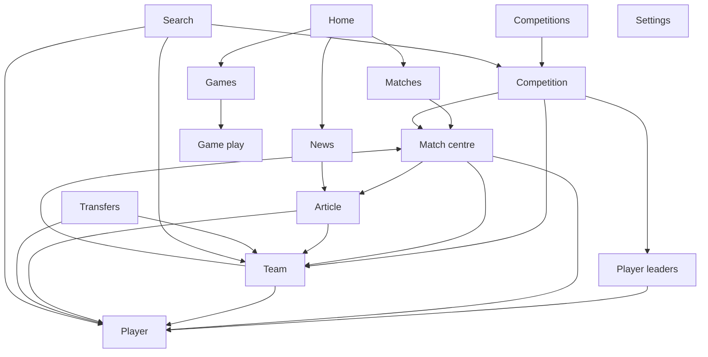
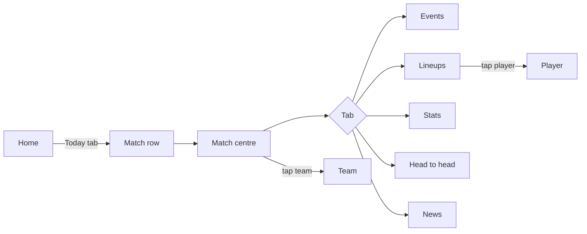
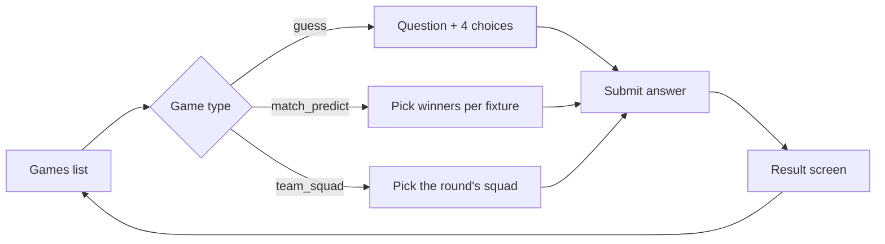

# 2. Information architecture, navigation and flows

## Principles

- **Sport is a level in the structure, not an assumption.** Every football route lives under
  `/football/…` and every entity carries `sport_id`. Adding basketball later means a new
  `/basketball/…` branch and a sport switcher, not a rewrite.
- **Region (API `service`) is the second axis.** Local, International, Africa, Saudi, Asian
  come from `GET /services`; competitions and matches are grouped by it.
- **Entity pages are the hubs:** Match, Competition, Team, Player, Article. Every list links to one.
- **Guest-only in v1.** There is no account API in scope, so there is no login, profile or
  personal area. The app shell keeps a slot for it (see [technical plan](05-technical-plan.md)).

## Sitemap

## Routes

Web uses path routes with a locale prefix so each page has a stable, indexable URL. Mobile uses
the same paths for deep links (`sports247://football/match/2578`, universal links later).

| Screen | Web route | Mobile route (Expo Router) |
|:--|:--|:--|
| S01 Home | `/ar` | `(tabs)/index` |
| S02 Matches | `/ar/football/matches?day=today` | `(tabs)/matches` |
| S03 Match centre | `/ar/football/match/:id/:tab?` | `football/match/[id]` |
| S05 Competitions | `/ar/football/competitions?region=` | `(tabs)/competitions` |
| S06 Competition | `/ar/football/competition/:id/:tab?season=` | `football/competition/[id]` |
| S07 Leaders list | `/ar/football/competition/:id/leaders/:kind` | `football/competition/[id]/leaders` |
| S08 Team | `/ar/football/team/:id/:tab?` | `football/team/[id]` |
| S09 Player | `/ar/football/player/:id/:tab?` | `football/player/[id]` |
| S10 Transfers | `/ar/football/transfers` | `more/transfers` |
| S11 News | `/ar/news` | `(tabs)/news` |
| S12 Article | `/ar/news/:id` | `news/[id]` |
| S13 Search | `/ar/search?q=` | `search` (modal) |
| S14 Games | `/ar/games` | `more/games` |
| S15–S17 Game play | `/ar/games/:id` | `games/[id]` |
| S18 Settings | `/ar/settings` | `more/settings` |

Tabs inside entity pages are part of the URL on web (shareable, back-button friendly).
`/en/...` routes exist in code but are disabled until English content ships.

## Navigation

| | Web (≥ 1024 px) | Web (< 1024 px) and mobile app |
|:--|:--|:--|
| Primary | Top bar: logo, Home, Matches, Competitions, News, Transfers, Games | Bottom tab bar: Home, Matches, Competitions, News, More |
| Secondary | — | More: Transfers, Games, Settings |
| Search | Search field in the top bar (opens S13) | Search icon in the screen header (opens S13 as a modal on mobile) |
| Theme | Toggle icon in the top bar | Settings |
| Entity tabs | Horizontal tabs under the page header | Scrollable segmented tabs, swipe between tabs on mobile |
| Back | Browser back; breadcrumb on entity pages | Header back button and system back/swipe gestures |

Why the difference: on desktop all six sections fit and search is used often, so they sit in the
top bar. On phones, five thumb-reachable tabs is the platform norm; Transfers and Games move to
More, and Games is also promoted on Home.

## Flows (guest)

### Check scores and follow a match

Live matches refresh by polling while the screen is visible (see technical plan). Leaving the
screen or backgrounding the app stops polling.

### Follow a competition

Competitions → region filter → Competition (Table tab by default for leagues, Matches for cups) →
team row → Team → Squad → Player.

### Read news

Home top stories or News → Article → tag chip (team or player) → entity page. Related articles at
the end of each article.

### Search

Search → type at least 2 characters → results grouped as Teams, Players, Competitions → entity
page. Debounced 300 ms. Empty, no-results and error states are defined in screens.

### Play a game

Games need a `user_identifier`. With no login in v1, the proposal is an anonymous ID generated on
first play and stored on the device (open question Q4 in the [README](README.md)). Played games
show a "Played" state from `is_played`.

### Preferences

Settings → Theme (Dark default, Light, System). Language row is present in code and hidden at
launch.

## Logged-in flow

Not in v1. Twist account management is out of scope and no 24/7 account API exists yet, so no
feature currently needs a session. When an account API arrives, login slots in as: More/Settings →
Sign in → (personal features the API supports) with the shell, token storage and refresh already
planned in the technical plan.
